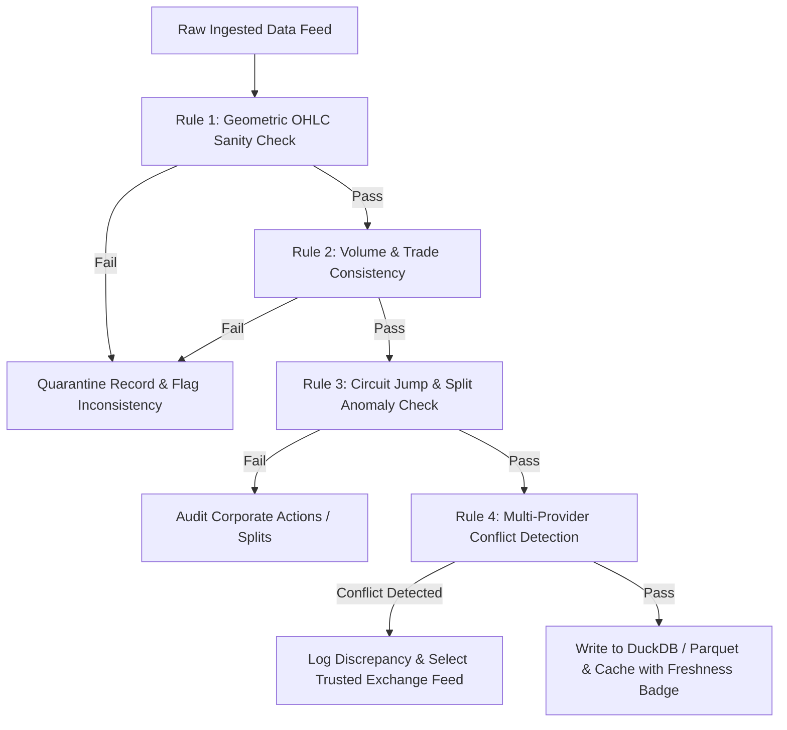

# DATA QUALITY & RELIABILITY SPECIFICATION: BHARAT MARKET INTELLIGENCE

**Core Mandate:** Truthful, verified Indian stock market research with absolute anti-hallucination guarantees.

---

## 1. Automated Data Quality Verification Rules

All incoming market data must pass through the `DataValidator` before being persisted or analyzed.

### Rule 1: Geometric OHLC Sanity Check
A candle is mathematically invalid and rejected if any of these conditions are violated:
$$High \ge \max(Open, Close, Low)$$
$$Low \le \min(Open, Close, High)$$
$$Open > 0, \quad Close > 0, \quad High > 0, \quad Low > 0$$

### Rule 2: Volume & Turnover Check
$$Volume \ge 0$$
$$\text{If } Volume = 0 \text{ during market hours, check if stock is suspended or in lower circuit.}$$
$$Turnover \ge 0$$
$$\text{Delivery Quantity} \le \text{Total Volume}$$

### Rule 3: Abnormal Jump & Corporate Action Check
If $|Close_t - Close_{t-1}| / Close_{t-1} > 20\%$:
- Check official NSE corporate action register for:
  - Stock split (e.g., 10:1, 5:1, 2:1)
  - Bonus issue (e.g., 1:1, 2:1)
  - Demerger or special dividend
- If corporate action confirmed: Flag back-adjusted series and raw series separately.
- If no corporate action found: Flag anomalous spike warning for review.

### Rule 4: Multi-Provider Conflict Detection
If primary provider (NSE) and secondary provider (Yahoo) diverge in LTP by $> 0.5\%$:
1. Both values are recorded with their respective source names and timestamps.
2. The UI Data Quality Panel displays a `SOURCE_DISCREPANCY` warning.
3. The official exchange quote is preferred for analysis.
4. Discrepancies are NEVER silently smoothed or overwritten.

---

## 2. Technical Indicator Warm-Up & Missing Data Rules

1. **Warm-Up Requirements:**
   - 200-day SMA requires at least 200 valid historical sessions. If $<200$ sessions exist, $SMA_{200}$ is returned as `None` / `null` with warning label: `INSUFFICIENT_HISTORY_FOR_200SMA`.
   - 14-period RSI requires at least 28 bars (14 for initial average + 14 for Wilder smoothing stabilization).
2. **Missing Data Imputation Strictly Banned:**
   - Missing bars are NEVER filled with arbitrary averages, random walks, or forward-fill heuristics.
   - If an exchange holiday or market closure occurs, the date is recorded as `MARKET_HOLIDAY`.
   - If a trading session has missing ticks, the gap is visibly identified on the chart.

---

## 3. Financial Statement Reconciliation Rules

1. **Standalone vs. Consolidated Distinction:**
   - Standalone and consolidated statements must never be mixed in the same ratio calculation.
   - Consolidated statements are preferred for multi-business conglomerates (e.g., Reliance, Tata Motors, L&T).
   - Standalone statements are explicitly used for pure operating holding companies where indicated.
2. **Period Alignment:**
   - Quarterly results (Q1, Q2, Q3, Q4) must be compared Year-on-Year (YoY) with the exact corresponding quarter of the prior financial year, and Quarter-on-Quarter (QoQ) with the immediately preceding quarter.
   - TTM (Trailing Twelve Months) is computed as:
     $$TTM = \sum_{q=1}^4 Quarter_q$$

---

## 4. Anti-Hallucination Barrier for AI Research Agents

The AI Market Research Agent operates under strict constitutional constraints:
1. **Zero Price Generation:** The AI agent is strictly forbidden from computing, predicting, or stating numerical stock prices, indicators, or ratios not present in the verified structured payload.
2. **Traceability:** Every statement generated in an AI research report must cite the specific data attribute (e.g., `source: NSE_BHAVCOPY_2026-11-12`, `metric: RSI_14 = 62.4`).
3. **Absence of Proof:** If data is missing or ambiguous, the AI agent is instructed to state: *"Data unavailable from official sources; no conclusion drawn."*
4. **Deterministic Backup:** If an AI provider (Gemini or Ollama) times out or hits quota limits, the local Rule-Based Analytical Engine immediately serves the report without interruption.

